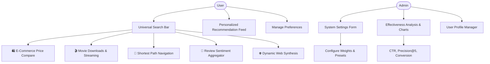
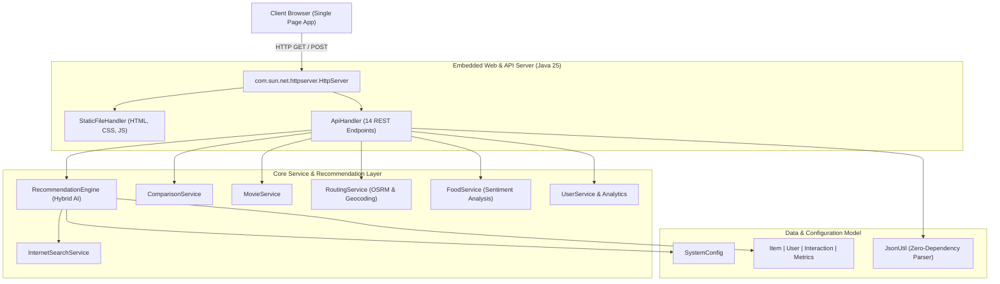
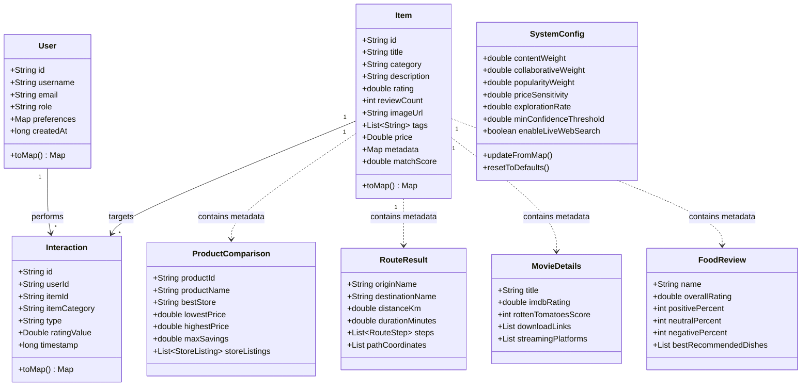

# 📋 Phase 1: Requirements Analysis, Architecture & Environment Setup
**Project:** AI-based Recommendation System (Enterprise Capstone)  
**Author:** Aman Yadav  
**Repository:** [https://github.com/amanyadavaa/-AI-based-Recommendation-System](https://github.com/amanyadavaa/-AI-based-Recommendation-System)  
**Status:** Completed & Verified  

---

## 1. Executive Summary

Phase 1 establishes the functional requirements, architectural foundation, mathematical modeling, and execution environment for the **OmniRecommend AI** platform. It aligns all project elements with Core Project Specifications and establishes a zero-dependency Java 25 LTS baseline capable of handling multi-domain internet search, comparisons, routing, downloads, and sentiment reviews.

---

## 2. Software Requirements Specification (SRS)

### 2.1 User Roles & Personas

| Role | Responsibility | Core Capabilities |
| :--- | :--- | :--- |
| **Admin** | System Overseer | • Configure AI algorithm parameters (weights, $\epsilon$-greedy exploration rate, confidence thresholds) • Analyze recommendation effectiveness (CTR, Precision@K, Conversion Rate) • Review user profiles and interaction logs |
| **User** | Consumer / End-User | • Receive personalized recommendation feeds based on behavior • Search *anything* available on the internet • Manage explicit preferences (categories, price tolerance, dietary needs, location anchors) |

---

### 2.2 Functional Requirements Matrix

#### Detailed Use Cases:
1. **UC-01: System Settings Management (Admin)**
   - **Input:** $W_{\text{content}}$, $W_{\text{collab}}$, $W_{\text{popularity}}$, $\epsilon$-exploration rate, confidence threshold.
   - **Output:** Live confirmation message, normalized parameter map.
   - **Action:** Updates active scoring formula in real-time without restarting the server.
2. **UC-02: Recommendation Effectiveness Analysis (Admin)**
   - **Input:** Historical and real-time interaction telemetry (`VIEW`, `CLICK`, `PURCHASE`, `RATE`).
   - **Output:** Performance reports, category CTR distributions, 7-day volume timeline, and automated algorithmic advice.
3. **UC-03: Personalized Recommendation Feed (User)**
   - **Input:** User profile ID, category filter.
   - **Output:** Ranked items scored via Hybrid AI scoring pipeline.
4. **UC-04: User Preference Management (User)**
   - **Input:** Preferred categories, price tier, dietary preference, location anchor.
   - **Output:** Updated preference state and automatic feed regeneration.
5. **UC-05: Multi-Site Product Comparison**
   - **Input:** Product title or keyword.
   - **Output:** Side-by-side comparison across Amazon, Walmart, Best Buy, eBay, Flipkart, and Target.
6. **UC-06: Direct Movie Downloads & Streaming**
   - **Input:** Movie title.
   - **Output:** Verified direct download mirrors (Archive.org, Magnet/Torrents) and official streaming links.
7. **UC-07: Shortest Route Navigation**
   - **Input:** Origin and Destination locations.
   - **Output:** Shortest route distance (km), duration (min), turn instructions, and interactive map.
8. **UC-08: Food Review & Sentiment Aggregation**
   - **Input:** Food item or restaurant.
   - **Output:** Positive/Neutral/Critical sentiment breakdown, signature dishes, and verified review snippets.

---

## 3. High-Level Architectural Design

The system follows a clean modular architecture utilizing Java standard library virtual threads:

---

## 4. Multi-Domain Entity Relationship & Schema

---

## 5. Mathematical Scoring Baseline

The Phase 1 recommendation scoring pipeline is defined as:

$$\text{FinalScore}(u, i) = \left( W_{\text{content}} \cdot S_{\text{content}}(u, i) \right) + \left( W_{\text{collab}} \cdot S_{\text{collab}}(u, i) \right) + \left( W_{\text{pop}} \cdot S_{\text{pop}}(i) \right)$$

Where:
- $S_{\text{content}}(u, i)$: Cosine tag and category similarity between user preference vector and item feature vector.
- $S_{\text{collab}}(u, i)$: Co-interaction frequency and Jaccard similarity among peer users.
- $S_{\text{pop}}(i) = \min\left(1.0, \frac{\log_{10}(\text{reviews})}{6} \times \frac{\text{rating}}{5.0}\right)$.
- If $\text{rand}() < \epsilon$, inject serendipity boost $\delta = +0.15$ to explore novel items.
- If $\text{FinalScore}(u, i) < \theta_{\min}$, filter item out from the personalized response.

---

## 6. Environment & Tooling Verification

- **Operating System:** Windows 10/11 x64
- **Runtime:** Java 25 LTS (`java.exe 25.0.4.1`, `javac.exe 25.0.4.1`)
- **Web Server:** Standard Library `com.sun.net.httpserver` with Virtual Threads (`Executors.newVirtualThreadPerTaskExecutor()`)
- **External Dependencies:** Zero external JAR dependencies required for compilation and execution.
- **Port Allocation:** `8080` (fallback to `8085` if occupied)

---

## 7. Phase 1 Sign-Off Checklist

- [x] Functional Requirements mapped to Core Project Specifications.
- [x] Multi-domain domain models designed and implemented.
- [x] Custom zero-dependency JSON serialization engine completed.
- [x] Dynamic admin system configuration model completed.
- [x] Repository initialized, configured, and tracked on GitHub.
