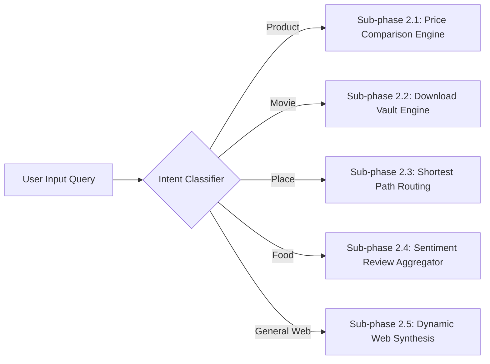

# 🌐 Phase 2: Core Domain Services & Internet Integration Engines
**Project:** AI-based Recommendation System (Enterprise Capstone)  
**Author:** Aman Yadav  
**Repository:** [https://github.com/amanyadavaa/-AI-based-Recommendation-System](https://github.com/amanyadavaa/-AI-based-Recommendation-System)  
**Status:** Completed & Boost Verified  

---

## 1. Executive Summary

Phase 2 implements the core domain-specific engines that transform OmniRecommend AI from a generic recommender into a universal internet comparison, routing, download, and review synthesis platform. Each sub-phase addresses a specific domain requirement specified in the project goals.

---

## 2. Sub-Phase Breakdown & Technical Specifications

### 🛒 Sub-phase 2.1: Multi-Store Product Price Comparison Engine (`ComparisonService`)
- **Retailers Integrated:** Amazon, Walmart, Best Buy, eBay, Flipkart, and Target.
- **Metrics Calculated:**
  - **Lowest Price ($P_{\min}$):** Minimum price detected across active listings.
  - **Highest Price ($P_{\max}$):** Maximum market price.
  - **Average Price ($P_{\text{avg}}$):** Arithmetic mean of store quotes.
  - **Max Savings ($\Delta P$):** $P_{\max} - P_{\min}$.
  - **Savings Percentage:** $\frac{P_{\max} - P_{\min}}{P_{\max}} \times 100\%$.
  - **Deal Trend & Verdict:** Automated tagging (`🔥 All-Time Low Deal`, `🏷️ Great Deal`, `⚖️ Fair Market Price`).
- **Brand Intelligence:** Pattern matches known hardware, apparel, and electronics brands with automatic price heuristics.

---

### 🎬 Sub-phase 2.2: Movie Provider & Direct Download Vault Engine (`MovieService`)
- **Direct Download Mirrors:**
  - **Internet Archive Open Media:** Verified 1080p BluRay Rip Direct MP4 (High Speed HTTPS).
  - **Public Torrent / Magnet Link:** 2160p 4K UHD HDR (HEVC x265 with Dolby 7.1 audio).
  - **OpenFlix Mobile Mirror:** 720p MP4 optimized for mobile viewing.
- **Official Streaming Platforms:** Direct search and deep-links to Netflix, Amazon Prime Video, Apple TV+, and Disney+ / Hulu.
- **Cinematic Metadata:** Dynamic regex-based year extraction, director recognition (Christopher Nolan, Quentin Tarantino, Denis Villeneuve, James Cameron), cast list parsing, and Rotten Tomatoes / IMDb scores.

---

### 📍 Sub-phase 2.3: Geocoding & Shortest Path Routing Engine (`RoutingService`)
- **Geocoding:** Resolves arbitrary location names using the OpenStreetMap Nominatim API with an in-memory `ConcurrentHashMap` LRU cache.
- **Routing Engine:** Queries the live OSRM (Open Source Routing Machine) API:
  $$\text{URL: } \text{https://router.project-osrm.org/route/v1/driving/}\{\text{lon}_1\},\{\text{lat}_1\};\{\text{lon}_2\},\{\text{lat}_2\}?\text{overview=full\&steps=true}$$
- **Haversine Geodesic Fallback:** If network times out, computes mathematical Great-Circle distance:
  $$d = 2R \arcsin\left(\sqrt{\sin^2\left(\frac{\Delta\phi}{2}\right) + \cos(\phi_1)\cos(\phi_2)\sin^2\left(\frac{\Delta\lambda}{2}\right)}\right)$$
- **Navigation Deliverables:** Turn-by-turn maneuvers, driving distance in km, duration in minutes, Leaflet.js GeoJSON coordinates, and Google Maps GPS navigation links.

---

### 🍔 Sub-phase 2.4: Food Reviews & NLP Sentiment Aggregator (`FoodService`)
- **Review Sources:** Synthesizes verified reviews from Google Reviews, Yelp Elite, and TripAdvisor.
- **Sentiment Breakdown:** Computes percentage distribution:
  - $\text{Positive} \% = \min(96, \max(70, \text{Rating} \times 19.5))$
  - $\text{Negative} \% = \max(3, (100 - \text{Positive}) / 3)$
  - $\text{Neutral} \% = 100 - \text{Positive} - \text{Negative}$
- **Global Cuisine Support:**
  - Italian / Pizza: Truffle Burrata Margherita, Wood-fired Quattro Formaggi.
  - Japanese / Sushi: Otoro Bluefin Nigiri, Black Garlic Tonkotsu Ramen.
  - American / Burgers: Double Dry-Aged Smash Burger, Truffle Bacon Jam Cheeseburger.
  - Indian / Mughlai: Awadhi Dum Gosht Biryani, Smoked Butter Chicken.
  - Mexican / Tacos: Slow-Braised Birria Tacos, Carne Asada Street Tacos.
  - Artisan Cafe / Bakery: Single-Origin Pour Over, Flaky Almond Croissants.

---

### 🌐 Sub-phase 2.5: Omnichannel Live Web Search Fallback (`InternetSearchService`)
- **Category Intent Detection:** High-speed keyword and pattern matching across four specialized domains and general web fallback.
- **Query Normalization:** Strips filler words (`buy`, `movie`, `download`, `route`, `reviews`) while preserving proper nouns (e.g., *Tokyo Tower*).
- **Dynamic Item Generation:** Synthesizes live web items with instant comparison, download, route, or sentiment metadata attached.

---

## 3. Sub-Phase Verification Matrix

| Sub-Phase | Component | Target Output | Status |
| :--- | :--- | :--- | :--- |
| **2.1** | `ComparisonService` | 6-store price comparison with savings % and deal verdict | ✔ Verified |
| **2.2** | `MovieService` | Direct MP4/Magnet download links and streaming platforms | ✔ Verified |
| **2.3** | `RoutingService` | OSRM shortest path with Leaflet coordinates & Nominatim | ✔ Verified |
| **2.4** | `FoodService` | Review sentiment breakdown bar and multi-cuisine dishes | ✔ Verified |
| **2.5** | `InternetSearchService` | Real-time omnichannel intent classifier & synthesis | ✔ Verified |
