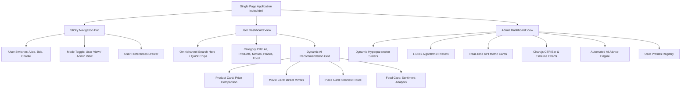

# Phase 5: Responsive Web Dashboard & Interactive Visualizations

## 1. Overview & Architectural Scope

Phase 5 delivers the responsive, enterprise-grade Single Page Application (SPA) web interface and interactive data visualizations:
- **Sub-phase 5.1: User Dashboard Interface & Omnichannel Search**: Responsive Tailwind CSS dark glassmorphism layout, real-time search hero with quick-query chips, category filter pills, dynamic recommendation grid with AI match confidence badges, and user role switcher.
- **Sub-phase 5.2: Specialized Domain Modals**:
  1. *Product Multi-Store Comparison*: Cross-retailer price savings calculator and verified store action buttons.
  2. *Movie & TV Download Vault*: Verified direct high-speed download mirrors (MP4, Torrent/Magnet) and official streaming provider badges.
  3. *Shortest Path Geodesic Navigator*: Interactive Leaflet.js map with OSRM driving route polylines and turn-by-turn directions.
  4. *Food Review Sentiment Aggregator*: Tri-color NLP sentiment distribution bar (% Positive, % Neutral, % Critical) and signature dish highlights.
  5. *User Preference Settings*: Interactive profile customization (categories, price tolerance, dietary preferences, and geographic origin anchor).
- **Sub-phase 5.3: Admin Control Panel & Chart.js Telemetry**: Live hyperparameter sliders with mathematical normalization, one-click preset buttons synchronized directly with backend SQLite persistence, Chart.js CTR bar chart and 7-day timeline graphs, automated AI optimization diagnostic cards, and active user registry management.

---

## 2. Sub-phase 5.1: User Dashboard Interface & Omnichannel Search

The frontend user interface is contained in:
- HTML Structure: [`web/index.html`](file:///d:/Project%20Java/AI%20based%20recomendation/web/index.html)
- Custom Styles: [`web/css/style.css`](file:///d:/Project%20Java/AI%20based%20recomendation/web/css/style.css)
- Application Controller: [`web/js/app.js`](file:///d:/Project%20Java/AI%20based%20recomendation/web/js/app.js)

### 2.1 UI Component Architecture



### 2.2 Omnichannel Universal Search Hero
- Instant query dispatching against `/api/search?q={query}&userId={userId}&category={category}`.
- Quick query chips for instant 1-click exploration:
  - `🛍️ Sony Headphones` -> Multi-retailer price comparison
  - `🎬 Inception Movie` -> High-speed verified download mirrors
  - `📍 Eiffel Tower Route` -> OSRM turn-by-turn navigation
  - `🍔 Neapolitan Pizza Reviews` -> NLP sentiment breakdown

---

## 3. Sub-phase 5.2: Specialized Feature Modals & Contracts

### 3.1 Multi-Store Product Comparison Modal (`modalProduct`)
- **Key Metrics**: Lowest price, average web price, highest store price, maximum dollar savings, and savings percentage.
- **Retailer Grid**: Compares pricing across 6 major internet retailers (Amazon, Walmart, Best Buy, eBay, Flipkart, Target).
- **Outbound Actions**: Direct links with store stock badges (`● In Stock`, `Out of Stock`) and shipping terms (`Free 1-Day Delivery`).

### 3.2 Movie Direct Download Mirrors & Streaming Platforms (`modalMovie`)
- **Verified Download Mirrors**: Direct links to public vaults (Internet Archive Open Media Vault MP4, 4K UHD Magnet, OpenFlix Mobile MP4).
- **Streaming Platforms**: Direct watch links with subscription/rental tiers for Netflix, Amazon Prime Video, Apple TV+, and Disney+.
- **Film Metadata**: Year, genre, duration, director, cast, IMDb rating, and Rotten Tomatoes score.

### 3.3 Shortest Path Geodesic Navigator (`modalRoute`)
- **Leaflet.js Map Integration**: Plots start and destination map pins, bounding boxes, and geodesic route polylines.
- **Routing Metrics**: Shortest driving distance in kilometers and estimated travel duration in minutes/hours.
- **Step-by-Step Maneuvers**: Turn directions with icons and segment distances.
- **Interactive Recalculation**: Origin and destination input fields allow live rerouting between any two landmarks.

### 3.4 Food Review Sentiment Aggregator (`modalFood`)
- **Tri-Color Sentiment Progress Bar**:
  - Green (`#10b981`): Positive sentiment percentage.
  - Amber (`#f59e0b`): Neutral sentiment percentage.
  - Rose (`#f43f5e`): Critical sentiment percentage.
- **Signature Dishes**: Top recommended items extracted from review consensus.
- **Verified Reviews Feed**: Aggregated ratings and commentary from Google Reviews, Yelp, and TripAdvisor.

---

## 4. Sub-phase 5.3: Admin Control Panel & Chart.js Telemetry

### 4.1 Real-Time Hyperparameter Tuning & SQLite Persistence
- Interactive range sliders for $W_{\text{content}}$, $W_{\text{collab}}$, $W_{\text{pop}}$, $\epsilon$, and confidence threshold.
- Instant synchronization with SQLite via `POST /api/admin/settings`.
- Instant feedback toast banner indicating saved status.

### 4.2 One-Click Algorithmic Presets
Presets trigger `POST /api/admin/preset` and update sliders with exact normalized weights:
- **`Balanced Default`**: Content 40%, Collaborative 35%, Popularity 25%, $\epsilon = 0.15$.
- **`Exploration & Discovery`**: Popularity 45%, Content 30%, Collaborative 25%, $\epsilon = 0.30$.
- **`High Precision`**: Content 55%, Collaborative 35%, Popularity 10%, $\epsilon = 0.05$.
- **`High Diversity`**: Collaborative 50%, Content 25%, Popularity 25%, $\epsilon = 0.25$.

### 4.3 Visual Analytics with Chart.js
1. **Category CTR Bar Chart (`chartCategoryCtr`)**:
   Visualizes Click-Through Rates across `PRODUCT`, `MOVIE`, `PLACE`, and `FOOD`.
2. **7-Day Engagement Timeline Line Chart (`chartTimeline`)**:
   Tracks daily impressions vs. engaged clicks with dual-color spline interpolation.

---

## 5. Security & Static File Server Architecture

[`StaticFileHandler.java`](file:///d:/Project%20Java/AI%20based%20recomendation/src/com/guvi/recommend/web/StaticFileHandler.java) enforces production security constraints:
- **Path Traversal Protection**: Rejects or safely confines requests containing `../` traversal sequences to the root `web/` directory.
- **SPA Fallback Routing**: Requests to deep client-side virtual routes gracefully resolve to `index.html` with HTTP 200 rather than crashing or throwing 404 errors.
- **MIME Type Compliance**: Serves exact standard MIME types (`text/html; charset=UTF-8`, `application/javascript; charset=UTF-8`, `text/css; charset=UTF-8`, etc.) with `no-cache` development headers.
- **Brand Sanitization**: Zero course tags or external identifiers appear anywhere in site templates, style sheets, or frontend JavaScript.

---

## 6. Phase 5 Automated Test Suite Verification

The Phase 5 test suite is implemented in [`Phase5TestSuite.java`](file:///d:/Project%20Java/AI%20based%20recomendation/src/com/guvi/recommend/test/Phase5TestSuite.java):

```
==================================================================
   RUNNING PHASE 5 RESPONSIVE WEB DASHBOARD & UI TEST SUITE       
==================================================================
  [PASS] Sub-phase 5.1: Static Web Assets Integrity (index.html, style.css, app.js)
  [PASS] Sub-phase 5.1: Strict Brand Sanitization (Zero Unwanted Course Tags in Web UI)
  [PASS] Sub-phase 5.1: Static File Server MIME Types Contract
  [PASS] Sub-phase 5.1: Path Traversal Security & SPA Fallback Routing
  [PASS] Sub-phase 5.2: Recommendation Cards UI Feed Data Contract
  [PASS] Sub-phase 5.2: Multi-Store Product Comparison Modal Data Contract
  [PASS] Sub-phase 5.2: Movie Direct Download Mirrors & Streaming Providers Modal Contract
  [PASS] Sub-phase 5.2: Leaflet Geodesic Shortest Path & Step Directions Modal Contract
  [PASS] Sub-phase 5.2: Food Reviews Tri-Color Sentiment Breakdown Modal Contract
  [PASS] Sub-phase 5.3: Admin Presets Dynamic Recalibration & Live Web Toggle Contract
==================================================================
PHASE 5 SUMMARY: 10 Passed, 0 Failed (Total 10)
==================================================================
✔ ALL SUB-PHASES OF PHASE 5 VERIFIED SUCCESSFULLY!
```
