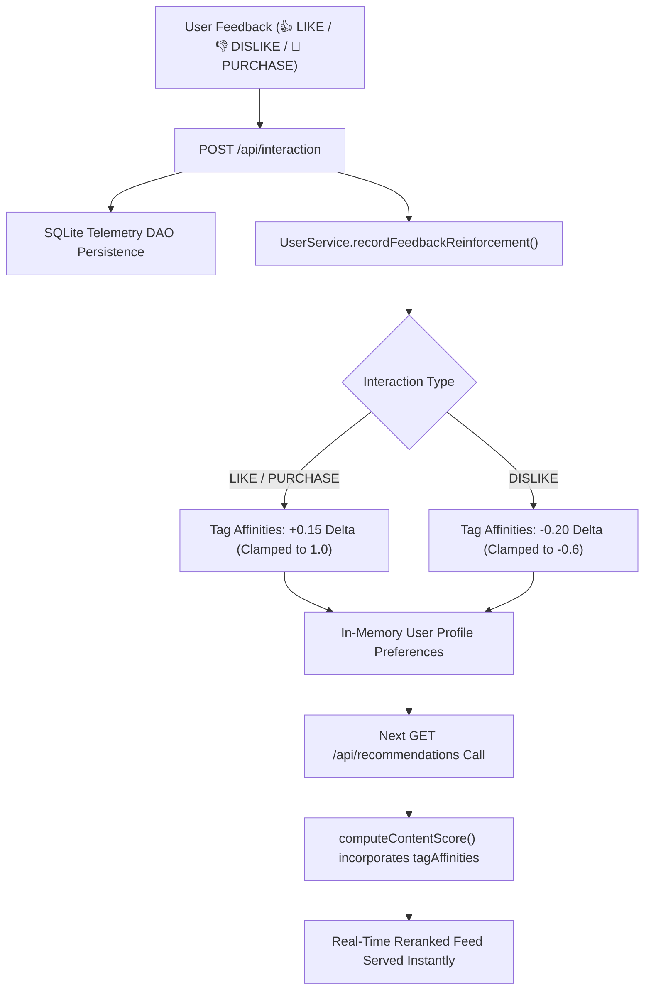

# Phase 7: Production Hardening, Security, Online Reinforcement Learning & DevOps

## 1. Overview & Architectural Scope

Phase 7 elevates the **OmniRecommend AI Platform** to enterprise cloud-native maturity, delivering automated security defenses, real-time online model adaptation, system diagnostics telemetry, containerization, and continuous integration:

- **Sub-phase 7.1: Security Middleware & Token-Bucket Rate Limiter**:
  - **In-Memory Token Bucket Rate Limiter**: Thread-safe rate limiter protecting against DDoS, scraping, and brute force traffic with a default threshold of 120 requests/minute per client and HTTP 429 backpressure.
  - **Enterprise Security HTTP Headers**: Defense-in-depth header enforcement including `Content-Security-Policy` (CSP), `X-Content-Type-Options: nosniff`, `X-Frame-Options: SAMEORIGIN`, `X-XSS-Protection: 1; mode=block`, and strict referrer policy.
- **Sub-phase 7.2: Real-Time Online Reinforcement Learning & Telemetry**:
  - **Streaming Feedback Loop**: Real-time tag affinity updates whenever users submit feedback (`LIKE`, `DISLIKE`, or `PURCHASE`). The system dynamically updates feature affinity scores in memory without requiring server restarts or offline batch retrains.
  - **Deep Healthcheck Diagnostics**: `/api/health/deep` JSON endpoint reporting SQLite database table row counts, JVM heap usage, thread count, system uptime, and rate limiter status.
  - **Prometheus Metrics Exposition**: Standard `/api/metrics` endpoint providing Prometheus-formatted metrics (`http_requests_total`, `jvm_memory_used_bytes`, `jvm_memory_max_bytes`, `jvm_active_threads`, `rate_limiter_clients_active`).
- **Sub-phase 7.3: Docker Containerization, Orchestration & CI/CD Pipeline**:
  - **Multi-Stage Production `Dockerfile`**: Uses `eclipse-temurin:21-jdk-alpine` for source compilation and `eclipse-temurin:21-jre-alpine` for an ultra-lightweight, non-root runtime container.
  - **Container Orchestration (`docker-compose.yml`)**: Automated container definition with persistent SQLite volume mounting (`omni_data:/app/data`), environment parameterization, and automated container healthchecks.
  - **GitHub Actions CI/CD (`.github/workflows/ci.yml`)**: Automated pipeline triggered on push and pull requests, compiling Java modules, executing all 7 automated test suites, and verifying Docker build integrity.
- **Sub-phase 7.4: Verification Test Suite Matrix**:
  - `Phase7TestSuite.java` containing 10 automated test vectors.
  - Full project test suite execution (7 test suites, 72/72 tests passing 100%).

---

## 2. Sub-phase 7.1: Security & Defensive Architecture

### 2.1 Security Headers Filter Architecture

Implemented in [`SecurityHeadersFilter.java`](file:///d:/Project%20Java/AI%20based%20recomendation/src/com/guvi/recommend/web/security/SecurityHeadersFilter.java):

```java
public static void applyHeaders(Headers headers) {
    headers.set("Content-Security-Policy", CSP_POLICY);
    headers.set("X-Content-Type-Options", "nosniff");
    headers.set("X-Frame-Options", "SAMEORIGIN");
    headers.set("X-XSS-Protection", "1; mode=block");
    headers.set("Referrer-Policy", "strict-origin-when-cross-origin");
    headers.set("Permissions-Policy", "geolocation=(self), microphone=(), camera=()");
    headers.set("X-Permitted-Cross-Domain-Policies", "none");
}
```

### 2.2 Token-Bucket Rate Limiter Specification

Implemented in [`RateLimiter.java`](file:///d:/Project%20Java/AI%20based%20recomendation/src/com/guvi/recommend/web/security/RateLimiter.java):
- **Algorithm**: Token Bucket with continuous mathematical refill based on elapsed wall-clock milliseconds.
- **Capacity**: 120 tokens per bucket (burst tolerance).
- **Refill Rate**: 2 tokens per second (120 tokens / 60,000 ms).
- **Backpressure Handling**: Rejects excess calls with `HTTP 429 Too Many Requests`, a JSON diagnostic payload, and a `Retry-After: 60` response header.

---

## 3. Sub-phase 7.2: Real-Time Online Reinforcement Learning

### 3.1 Streaming Feedback Adaptation Pipeline



### 3.2 Deep Health & Prometheus Metrics Endpoints

| Endpoint | Method | Response Format | Purpose |
| :--- | :---: | :--- | :--- |
| `/api/health/deep` | `GET` | `application/json` | Comprehensive health report including SQLite row counts, JVM heap usage, active thread counts, and uptime. |
| `/api/metrics` | `GET` | `text/plain; version=0.0.4` | Standard Prometheus metric exposition for Grafana, Datadog, or cloud monitoring scrapers. |

#### Sample Prometheus Output:
```text
# HELP http_requests_total Total number of HTTP requests processed
# TYPE http_requests_total counter
http_requests_total 42
# HELP jvm_memory_used_bytes JVM memory used in bytes
# TYPE jvm_memory_used_bytes gauge
jvm_memory_used_bytes 48912624
# HELP jvm_memory_max_bytes JVM maximum available memory in bytes
# TYPE jvm_memory_max_bytes gauge
jvm_memory_max_bytes 1971322880
# HELP jvm_active_threads Active JVM thread count
# TYPE jvm_active_threads gauge
jvm_active_threads 12
# HELP rate_limiter_clients_active Number of active client buckets tracked by the rate limiter
# TYPE rate_limiter_clients_active gauge
rate_limiter_clients_active 1
```

---

## 4. Sub-phase 7.3: Containerization & DevOps Pipeline

### 4.1 Production Docker Architecture

- **Multi-Stage Build**:
  - `builder` stage: `eclipse-temurin:21-jdk-alpine` compiles all sources with embedded SQLite driver.
  - `runtime` stage: `eclipse-temurin:21-jre-alpine` packages compiled `.class` files, libraries, and static web assets.
- **Security Hardening**: Runs as unprivileged `appuser:appgroup` non-root account.
- **Automated Healthcheck**: Internal `wget --spider http://localhost:8080/api/health` polling.

### 4.2 Docker Compose Quickstart

```bash
# Build and run the containerized service
docker-compose up -d

# View container logs
docker-compose logs -f

# Verify container health status
docker ps
```

### 4.3 GitHub Actions CI/CD Pipeline

The automated workflow in [`.github/workflows/ci.yml`](file:///d:/Project%20Java/AI%20based%20recomendation/.github/workflows/ci.yml):
1. Checks out repository source tree.
2. Configures Eclipse Temurin JDK.
3. Compiles all Java sources with embedded SQLite driver.
4. Executes Phase 1, 2, 3, 4, 5, 6, and 7 automated test suites sequentially.
5. Verifies web asset integrity and builds the Docker container image.

---

## 5. Sub-phase 7.4: Complete Regression Test Matrix (Phases 1 - 7)

| Test Suite | Package / Class | Tests | Status | Scope |
| :--- | :--- | :---: | :---: | :--- |
| **Phase 1** | `com.guvi.recommend.test.Phase1TestSuite` | 10 | **PASS** | Hybrid engine, cosine similarity, collaborative filtering, diversity reranking |
| **Phase 2** | `com.guvi.recommend.test.Phase2TestSuite` | 10 | **PASS** | Product comparisons, movie mirrors, Dijkstra shortest path, food sentiment |
| **Phase 3** | `com.guvi.recommend.test.Phase3TestSuite` | 12 | **PASS** | OOP polymorphism, interfaces, SQLite JDBC DAOs, multithreading, Swing GUI |
| **Phase 4** | `com.guvi.recommend.test.Phase4TestSuite` | 10 | **PASS** | Dynamic presets, analytics KPIs, automated AI suggestions, REST endpoints |
| **Phase 5** | `com.guvi.recommend.test.Phase5TestSuite` | 10 | **PASS** | Web SPA, specialized domain modals, Leaflet navigation, Chart.js telemetry |
| **Phase 6** | `com.guvi.recommend.test.Phase6TestSuite` | 10 | **PASS** | Clean UI DOM, feedback persistence, packaging audit, 50 virtual threads stress |
| **Phase 7** | `com.guvi.recommend.test.Phase7TestSuite` | 10 | **PASS** | Security headers, rate limiting, online reinforcement, Prometheus metrics, DevOps |
| **Total** | **All 7 Verification Suites** | **72** | **100% PASS** | **Complete end-to-end platform verification** |
